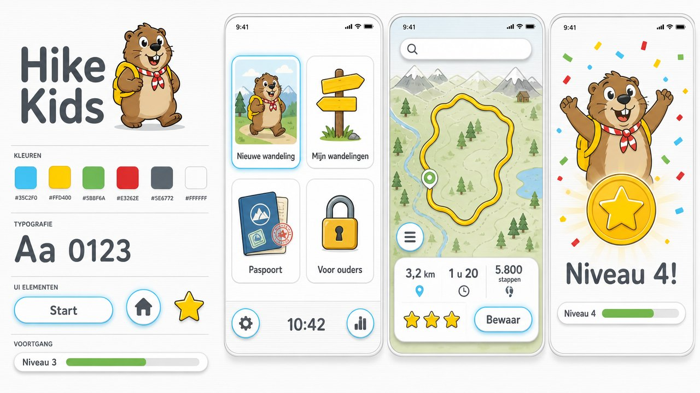

# Hike Kids

iPhone-app waarmee kinderen van 4 tot 12 jaar zelf een wandeling maken, overal in Europa.
Mo de marmot vraagt waar je wilt beginnen en hoe ver je wilt lopen, en tekent dan een rondje
over wandelpaden dat bij je leeftijd past.

Hike Kids is een afsplitsing van [Hike](https://github.com/aireport-online/hike), de planner
voor volwassenen. De kaart, de routeberekening en de opslag zijn dezelfde; alles eromheen is
voor kinderen gemaakt. Versie 2 heeft een spelachtige interface in de huisstijl **Kanalen**,
met animaties, sterren en niveaus. Zie [docs/HUISSTIJL.md](docs/HUISSTIJL.md).



## Wat een kind ermee doet

De app opent als het hoofdmenu van een spelcomputer: vier grote tegels, Mo die zwaait, je
niveau en onderaan een klok. Alles veert en gloeit zacht.

1. **Hoe oud ben jij?** – 4–5, 6–8 of 9–12 jaar. Daar hangt van af hoe ver en hoe snel.
2. **Nieuwe wandeling** – de kaart groeit uit de tegel. Tik waar je wilt beginnen, of zoek een plek.
3. **Hoe ver wil je lopen?** – kort, middel of lang. Mo maakt een rondje dat terugkomt bij het
   begin. "Andere kant" legt hetzelfde rondje een andere kant op. Zelf punten tikken en
   verschuiven kan ook.
4. **Bekijk je wandeling** – hoe ver, hoe lang met pauzes, hoeveel stappen, en hoeveel sterren
   ze waard is. Klimmen wordt uitgelegd in giraffen, Domtorens en Eiffeltorens.
5. **Onderweg kom je tegen** – speeltuinen, uitkijkpunten, dieren, een ijsje, een kasteel, een
   bergtop: als plaatjes op de kaart en in een rijtje.
6. **Bewaar** de wandeling; ze hangt daarna als bord aan de wegwijzer bij **Mijn wandelingen**.
7. **Gelopen!** – zet een stempel bij een wandeling die je gedaan hebt: confetti, sterren, en
   je niveaubalk loopt vol.
8. **Paspoort** – je niveau (van Beginner tot Wandelkampioen), je kilometers en acht stempels
   om te verdienen.

## Voor ouders

Achter de tegel "Voor ouders" en een som (bijvoorbeeld 7 × 8) zit het oudergedeelte:

- de leeftijdsgroep wijzigen, met de vuistregels die de app daarvoor gebruikt;
- de kaartsoort: kinderen beginnen op een eenvoudige kaart (groen, water, wegen en namen);
  hier staan ook de topografische kaart, OpenStreetMap, satelliet en de laag met gemarkeerde
  wandelroutes;
- een route omkeren, een stuk als rechte lijn tekenen, GPX delen en importeren.

De vuistregels (snelheid, pauzes, wat "ver" is) zijn voorzichtig gekozen en staan in
`HikeCore/Sources/HikeCore/KidProfile.swift`. Het blijven vuistregels: een ouder kent het kind.

### Privacy

Geen account, geen reclame, geen aankopen, geen meetsoftware. Wandelingen blijven op het
toestel. Kaarten, zoeken en routeberekening lopen via openbare diensten; daarbij gaat alleen
de plek op de kaart mee. Links naar buiten de app zijn er voor kinderen niet.

## Op je iPhone zetten

Nodig: een Mac met Xcode 16 of nieuwer en een iPhone met iOS 17 of nieuwer.

1. Open `Hike.xcodeproj` in Xcode.
2. Kies bij het target **Hike → Signing & Capabilities** je eigen team (een gratis Apple-ID
   werkt). De app heet op het toestel "Hike Kids" en kan naast Hike staan.
3. Kies een simulator of je iPhone als doel en druk op Run.

## Opbouw

| Map | Inhoud |
| --- | --- |
| `Hike/` | De app (SwiftUI + MapKit). De huisstijl en de animaties staan in `Hike/Brand/`, de schermen in `Hike/Screens/`. |
| `HikeCore/` | Swift-package zonder Apple-afhankelijkheden: routemodel, statistiek, GPX, opslag, de clients voor routes en zoeken, en de kindlogica (`KidProfile`, `LoopPlanner`, `Discovery`, `Passport`, `WalkerLevel`). |
| `HikeTests/` | Unit-tests van de planner met nagebootste diensten: rondjes maken en bijsturen, plekken onderweg, het paspoort. |
| `HikeUITests/` | Rooktest die de echte app bedient zoals een kind en een ouder dat doen. |

De rooktest draait bij elke push ook in GitHub Actions; de schermafbeeldingen per stap en een
schermopname van de hele doorloop staan daarna als artefacten (`screenshots`, `walkthrough`) bij de run.

Alle tests draaien in Xcode met ⌘U. De kernlogica is ook los te testen, zonder Mac:

```bash
cd HikeCore && swift test
```

Met `HIKE_LIVE_TESTS=1 swift test --filter LiveServiceTests` draaien ook de tests die de echte
diensten aanroepen.

## Diensten

De app gebruikt openbare diensten zonder account of sleutel:

| Dienst | Waarvoor |
| --- | --- |
| [BRouter](https://brouter.de) | Routeberekening over wandelpaden, met hoogtes |
| [OpenTopoMap](https://opentopomap.org) en [OpenStreetMap](https://www.openstreetmap.org) | Kaarttegels |
| [Waymarked Trails](https://hiking.waymarkedtrails.org) | Laag met bewegwijzerde routes |
| [Photon](https://photon.komoot.io) | Zoeken op plaatsnaam en plekken langs de route |

Dit zijn gedeelde diensten die door vrijwilligers en donaties draaien; prima voor eigen gebruik,
maar niet bedoeld voor een app met veel gebruikers. Wie de app breed wil uitbrengen, zet eigen
servers neer of neemt een betaalde dienst. Plekken zonder naam op de kaart (veel kleine
speeltuintjes) vindt de zoekdienst niet.

Kaartgegevens © OpenStreetMap-bijdragers (ODbL).
