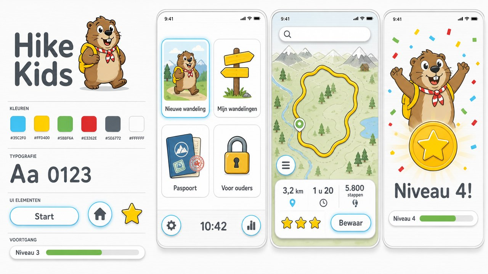
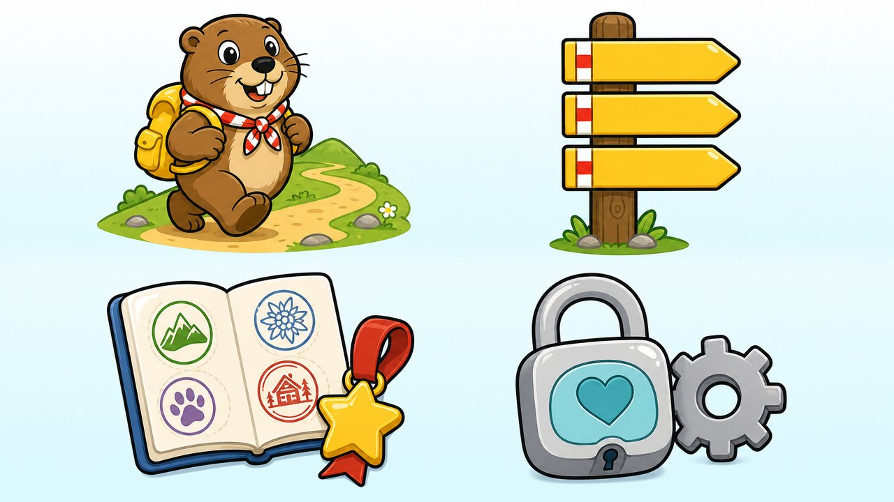

# Huisstijl: Kanalen

Hike Kids 2 voelt als het hoofdmenu van een spelcomputer uit de jaren 2000: wit, rustig,
glanzend, met grote ronde tegels en een zachtblauwe gloed om wat je kiest. Alles beweegt een
beetje. Mo de marmot loopt mee.

De stijl is geïnspireerd op dat tijdperk, niet nagemaakt: er staan geen logo's, figuren of
onderdelen van een bestaand merk in.

## Kleur

| Naam | Waarde | Gebruik |
| --- | --- | --- |
| Wit | `#FFFFFF` | Tegels, kaarten en knoppen |
| Nevel | `#F3F5F8` | De achtergrond, met dunne horizontale streepjes |
| Gloed | `#35C2F0` | Om de gekozen tegel en de knop die je nu moet indrukken; accenten |
| Leisteen | `#414953` | Koppen en cijfers |
| Grijs | `#5E6772` | Lopende tekst, pictogrammen |
| Rand | `#D5DBE2` | De dunne rand van tegels en knoppen |
| Wegwijzergeel | `#FFD400` | De route, sterren, gehaalde stempels en de borden met wandelingen |
| Grasgroen | `#5BBF6A` | De niveaubalk-af, "Lekker rondje!", het stempel "Gelopen!" |
| Markeringsrood | `#E3262E` | Alleen voor "erg ver" en foutmeldingen |

In de donkere modus worden wit en nevel donkergrijs; gloed en geel blijven.

## Vorm

- **Kanaaltegels**: grote witte tegels met ronde hoeken (22 pt), een dunne rand, een zachte
  schaduw, een illustratie en de naam eronder.
- **Kaarten**: hetzelfde oppervlak voor het wandelpaneel, de beloning en het paspoort.
- **Pilknoppen**: wit met een dunne rand; de knop die nu aan de beurt is heeft een dikke
  blauwe rand die zacht ademt.
- **Ronde knoppen** met een blauwe ring: terug naar het menu, waar ben ik, stap terug.
- **Borden**: bewaarde wandelingen blijven gele wegwijzerborden aan een paal.
- **De balk onderaan het menu** heeft links en rechts een ronde knop en in het midden de klok.

## Letter

**Fredoka** (SemiBold voor koppen, cijfers en knoppen; Medium voor tekst), in gewone zinnen.
Open licentie (SIL OFL), meegeleverd in `Hike/Brand/Fonts/`.

## Beweging

Alles veert zacht en heeft nooit haast.

| Wat | Hoe |
| --- | --- |
| Een tegel of knop indrukken | Krimpt iets en veert terug, met een tikje in je hand |
| Een kanaal openen | Het scherm groeit uit de tegel en krimpt er weer in terug |
| Tegels, knoppen en stempels verschijnen | Springen één voor één in beeld |
| Mo | Deint zacht op en neer |
| De gekozen tegel, de knop die aan de beurt is | De blauwe gloed ademt |
| Cijfers van een wandeling | Rollen naar hun nieuwe waarde |
| Sterren | Vallen één voor één op hun plek |
| Een wandeling gelopen | Confetti, Mo juicht, de niveaubalk loopt vol |

Wie op het toestel "Verminder beweging" aan heeft staan, krijgt alles zonder veren, zweven
en confetti. De bouwstenen staan in `Hike/Brand/Motion.swift`.

## Het spel

- **Sterren**: een wandeling die bij je leeftijd past is één tot drie sterren waard, meer voor
  een groter avontuur. Een wandeling die te ver is levert geen sterren op, zodat te veel doen
  nooit de manier is om te winnen.
- **Niveaus**: elke gelopen wandeling telt mee (meters plus acht keer de hoogtemeters). Niveau
  2 begint bij 2 km, niveau 3 bij 5 km, daarna steeds een kilometer meer. De niveaus heten
  Beginner, Stapper, Padvinder, Bosloper, Trekker, Heuvelheld, Bergwandelaar, Topklimmer,
  Alpenkenner en Wandelkampioen.
- **Stempels**: acht in het paspoort, zoals "Eerste stappen" en "Klimgeit".

## Mo

Een alpenmarmot met een gele rugzak en een rood-witte halsdoek, in drie houdingen (zwaaien,
juichen, wijzen), vrijstaand op de pagina.

## Taal

Korte zinnen, je en jij: "Hoe ver wil je lopen?", "Oeps! Hier vind ik geen wandelpad." Wat
voor ouders bedoeld is staat achter een som en gebruikt u.

## Ontwerp

De huisstijl, de tegelillustraties, Mo en het icoon zijn als beeld ontworpen met de
beeldgenerator van ElevenLabs en daarna in code nagebouwd. In de code staat alles in
`Hike/Brand/`; de beelden staan in `Hike/Assets.xcassets`.
