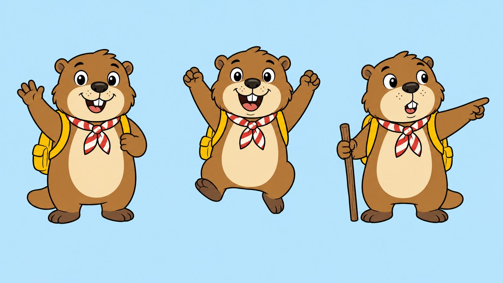
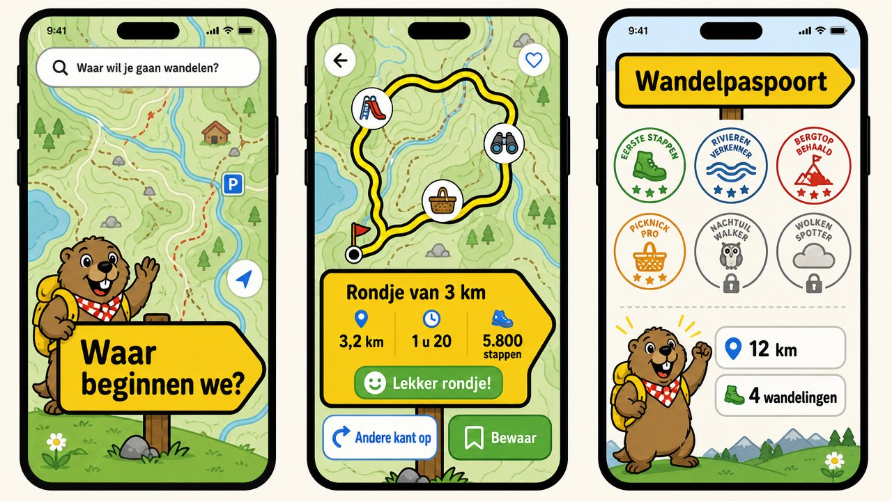

# Huisstijl: Hike Kids

Hike Kids neemt de gele wandelwegwijzer van Hike over en maakt hem rond, groot en vriendelijk,
met Mo de marmot als wandelmaatje.

## Mo

Mo is een alpenmarmot met een gele rugzak en een rood-witte halsdoek. Hij stelt de vragen
("Waar beginnen we?", "Hoe ver wil je lopen?") en juicht in het wandelpaspoort. Er zijn drie
houdingen: zwaaien, juichen en wijzen. Mo staat altijd in een ronde, hemelsblauwe lijst.

## Kleur

| Naam | Waarde | Gebruik |
| --- | --- | --- |
| Wegwijzergeel | `#FFD400` | Borden: het wandelpaneel, bewaarde wandelingen, gehaalde stempels, de routelijn |
| Inkt | `#1A1A1A` | Letters op geel, dikke omlijning, de hoofdknop |
| Hemelsblauw | `#B5E3FC` | Achter Mo en op het welkomstscherm |
| Grasgroen | `#5BBF6A` | "Lekker rondje!" en het stempel "Gelopen!" |
| Markeringsrood | `#E3262E` | Alleen als accent: "erg ver", foutmeldingen, de markering |

## Letter

**Fredoka** (SemiBold voor koppen, cijfers en knoppen; Medium voor lopende tekst), in gewone
zinnen met hoofdletter en kleine letters: dat leest voor beginnende lezers makkelijker dan
kapitalen. Fredoka valt onder de SIL Open Font License; de licentie staat bij de bestanden in
`Hike/Brand/Fonts/`.

## Vorm

- **Het bord** met één punt, nu met ronde hoeken en een dikke inktlijn (2,5 pt).
- **Knoppen** zijn minstens 52 pt hoog, wit met een dikke lijn; de hoofdknop is inkt met gele letters.
- **Plekken onderweg** zijn plaatjes op een wit rondje: 🛝 🔭 🧺 🐐 🍦 🏰 💦 ⛰️.
- **Stempels** in het wandelpaspoort zijn geel als ze gehaald zijn en grijs gestippeld als ze nog te halen zijn.

## Taal

Korte zinnen, je en jij, geen vaktaal: "Hoe ver wil je lopen?", "Oeps! Hier vind ik geen
wandelpad." Wat voor ouders bedoeld is staat achter een som en gebruikt u.

## Ontwerp

De schermen, Mo en het icoon zijn eerst als beeld ontworpen met de beeldgenerator van
ElevenLabs en daarna in code nagebouwd.

In de code staat alles in `Hike/Brand/`; Mo staat in `Hike/Assets.xcassets`.
